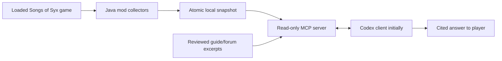

# Architecture and contracts

## Data flow



Only the MCP server, snapshot reader, and local corpus search exist in this commit. Collectors, in-game UI, and automated web retrieval are planned.

## OpenAI connection

**Development path:** sign into an existing Codex client with ChatGPT, then add this stdio MCP. No OpenAI secrets are needed by the MCP process. Check account/plan limits in the client. Official references: [authentication](https://learn.chatgpt.com/docs/auth), [MCP configuration](https://learn.chatgpt.com/docs/extend/mcp?surface=cli).

**Custom in-game experience:** evaluate the official [ChatGPT plan usage flow](https://developers.openai.com/siwc/token-sharing-open-source) for eligible local/open-source applications and [Codex app-server](https://learn.chatgpt.com/docs/app-server). This is a proposed integration, not implemented login. Verify registration and distribution eligibility, obtain consent, keep credentials in OS storage, and support disconnect/revocation. Never reuse Codex's client identity or steal existing tokens.

The [preview limitations](https://developers.openai.com/siwc/token-sharing-open-source/preview-limitations) exclude hosted MCP on this route. Execute MCP locally and bridge results through supported function tools, or use documented app-server support. Do not promise arbitrary subscription-funded API calls. A separately selected API-key mode would be separately billed. Do not silently fall back to paid API calls.

For a direct plan-usage integration, the documented constraints include streamed, non-stored Responses calls and supported model discovery. Do not bake a model name into the mod; discover choices for the signed-in account. Authentication and inference implementation are deferred to their own milestone.

## Game bridge

Implement a Java script mod against the user's installed build and its shipped modding examples. The published game documentation repository links to a getting-started page that is currently only a heading, so it cannot establish Java signatures or comprehensive state access. Consult local shipped documentation and source *as references only*, without redistributing them. The exact Java version, SCRIPT hooks, lifecycle callbacks, and field mappings remain unverified.

Collectors run through the game-supported simulation update lifecycle. Build a consistent immutable snapshot on the game thread; offload serialization and file I/O. Never walk mutable game objects from MCP/network threads. Publish with a temporary file and same-directory atomic replace. Start with a 2-second configurable capture interval and measure cost before making a performance claim.

Write an unloaded/tombstone snapshot as soon as the save unloads; rotate `session_id` on every load/new game. A 30-second freshness timeout is a fallback when the exporter stops unexpectedly, so a recent snapshot alone is not proof that the game is still loaded. A later session handshake/heartbeat should tighten this window. Paused games continue a wall-clock heartbeat without advancing the simulation tick. On unsupported builds fail with a clear compatibility error; don't silently omit domains.

## Snapshot v1

`snapshot.example.json` is a synthetic valid envelope. `Snapshot` in `syx_mcp.py` is the authoritative validation model. JSON Schema can be generated with:

```sh
.venv/bin/python -c 'import json; from syx_mcp import Snapshot; print(json.dumps(Snapshot.model_json_schema(), indent=2))'
```

Required metadata: schema version, game version, loaded flag, demo flag, opaque session and snapshot IDs, nonnegative tick, UTC/offset-aware capture time, active mods, and explicit coverage for every known domain. “Complete” means complete relative to a documented collector contract for a supported build, never all Java memory.

Domains target population, resources, production, employment, services, housing, health, law, happiness, research, trade, diplomacy, military, world, map, entities, events, and settings. Each carries `complete`, `partial`, or `unavailable`, a reason, and JSON data. Entity/map arrays need stable IDs, units, page semantics and per-build field definitions before implementation. Current v1 payloads are intentionally extensible; these domain schemas have not been invented from unverified game APIs.

Read queries take a domain and RFC 6901 JSON pointer, with array pagination (maximum 100 items). A caller can pin `expected_snapshot_id`; a changed snapshot forces retry, preventing silent joins across ticks. Results include provenance and coverage. Inputs are bounded to 16 MiB and results to 64 KiB; a future chunked exporter is needed for city/entity datasets that exceed this prototype limit.

## Evidence and citations

`corpus.example.json` is empty by design. An operator may place a JSON array in `SYX_STATE_DIR/corpus.json`. Each record follows the `Source` model: stable `id`, title, direct HTTPS URL, kind (`official`, `guide`, `forum`), retrieval time, optional publication time, explicit game versions if verified, and a short licensed excerpt or original factual summary. Do not guess a version from a title or assert unknown compatibility.

`source-directory.json` lists starting places for future retrieval. A directory entry is not evidence for a gameplay claim. Retrieval must capture the actual specific guide/post URL and the supporting passage. Respect site access rules, attribution and licenses; do not scrape private Discord or bundle full copyrighted guides.

The prototype searches only local reviewed records. Automated discovery, fetch, freshness refresh and deduplication are future work. Version mismatches remain visible rather than being silently discarded; the assistant must not treat them as established current mechanics. Retrieved content and game strings are untrusted data, never authority to run instructions or reveal secrets.

Answer format: (1) observation with snapshot/tick/pointer, (2) supported mechanic with direct source URL, (3) inference clearly labeled, (4) suggested action and uncertainty. If evidence is absent, say so. A status flag or citation does not by itself guarantee correctness; end-to-end answer quality needs evaluation.

## Privacy and trust

The MCP process uses stdio, reads only two operator-configured files, and opens no listener. It has no gameplay mutation, shell, arbitrary URL fetch, or arbitrary file-read tool. OS permissions must keep the runtime directory private to the user. The advisor only sends queried state to the AI client; the client may then transmit that content for inference with user consent. Optional remote access requires a separate authenticated design. Third-party strings must never override advisor instructions.
